<div align="center">

<p align="center">
  
</p>

# 🛡️⚡ Awesome Automated Threat & Anomaly Detection

**A curated, production-grade directory of cutting-edge SaaS platforms, open-source EDR/XDR systems, behavioral anomaly engines (UEBA), and network security monitoring frameworks.**

<p align="center">
  <a href="https://github.com/ishandutta2007/Awesome-Awesome-Awesome"></a>
  <a href="https://discord.gg/jc4xtF58Ve"></a>
  <a href="https://github.com/ishandutta2007/Awesome-Automated-Threat-Anomaly-Detection/stargazers"></a>
  <a href="https://github.com/ishandutta2007/Awesome-Automated-Threat-Anomaly-Detection/network/members"></a>
  <a href="https://github.com/ishandutta2007/Awesome-Automated-Threat-Anomaly-Detection/issues"></a>
  <a href="https://github.com/ishandutta2007/Awesome-Automated-Threat-Anomaly-Detection/blob/main/LICENSE"></a>
  <a href="https://github.com/ishandutta2007"></a>
</p>

<p align="center">
  <b>🔍 Behavioral Analytics &bull; 🤖 Automated Threat Response &bull; 🎯 Endpoint &amp; Cloud Telemetry &bull; 🌐 Network Security</b>
</p>

---

</div>

## 📑 Table of Contents
- [📌 Overview & SEO Highlights](#-overview--seo-highlights)
- [📈 Sector Overview & Market Dynamics](#-sector-overview--market-dynamics)
- [🏢 Enterprise SaaS Platforms](#-enterprise-saas-platforms)
- [🔓 Open-Source GitHub Projects](#-open-source-github-projects)
- [🏗️ Recommended Architecture & Framework Combinations](#️-recommended-architecture--framework-combinations)
- [🤝 How to Contribute](#-how-to-contribute)
- [💖 Support](#-support)
- [📊 Star History](#-star-history)
- [⚖️ Disclaimer](#️-disclaimer)

---

## 📌 Overview & SEO Highlights

Welcome to the **Awesome Automated Threat & Anomaly Detection** knowledge base! In modern enterprise security operations (SecOps), traditional rule-based alerting falls short against advanced persistent threats (APTs), zero-day exploits, and ransomware attacks. This repository provides a comprehensive index of **AI/ML-powered anomaly detection solutions**, **SIEM/SOAR automation pipelines**, and **MITRE ATT&CK-aligned threat hunting suites**.

### 🔑 Targeted Keywords & Search Capabilities
* **Endpoint Detection and Response (EDR):** Host kernel auditing via eBPF/ETW, continuous process tree tracking, real-time memory anomaly detection, and automated host isolation.
* **Extended Detection and Response (XDR):** Multi-telemetry alert correlation fusing endpoint telemetry, identity access management (IAM/AD) logs, cloud control plane events, and deep packet inspection (DPI).
* **User and Entity Behavior Analytics (UEBA):** Unsupervised ML (Isolation Forest, Autoencoders, clustering) establishing baseline user/host behavior to flag credential theft, lateral movement, and data exfiltration.
* **Automated Threat Response (SOAR):** Playbook-driven remediation workflows, automated forensic artifact collection, quarantine containment, and clean snapshot rollbacks.

---

## 📈 Sector Overview & Market Dynamics

The global automated threat detection and response market—spanning Endpoint Detection and Response (EDR) and Extended Detection and Response (XDR)—is estimated at approximately **$17B to $20B+** (with EDR valued at ~$6.5B growing at ~20% CAGR and XDR scaling from ~$11B towards $38B+ at an aggressive ~28% CAGR). 

The market exhibits **moderate concentration among top-tier platform giants** (such as Microsoft, CrowdStrike, and Palo Alto Networks) dominating core enterprise SOC budgets, while remaining **highly fragmented across specialized niches** (such as identity threat detection & response [ITDR], cloud-native application protection [CNAPP], container runtime security, and specialized managed detection [MDR] services).

---

## 🏢 Enterprise SaaS Platforms

The table below lists industry-leading commercial threat detection and automated response platforms, sorted in descending order by **parent company valuation or market capitalization**.

| 🌐 Company Valuation / Size | 🛡️ Platform / Product | 📝 Architecture & Description | 💵 Starting Pricing | 🎁 Free Tier / Evaluation Limits |
| :--- | :--- | :--- | :--- | :--- |
| **~$3.95T**<br>`(Public: MSFT)` | [**Microsoft Defender for Endpoint**](https://www.microsoft.com/en-us/security/business/endpoint-security/microsoft-defender-endpoint) | Integrated EDR with behavioral blocking, attack surface reduction, automated investigation, and remediation built natively into the Microsoft 365 ecosystem. | **$3.00/user/month** (Plan 1) / **$5.20/user/month** (Plan 2 standalone) / **$12.00/user/month** (E5 Security Add-on) | **30-day free trial**; capped at **25 user licenses** with full Defender for Endpoint & Defender XDR investigation capabilities. |
| **~$1.55T**<br>`(Public: AVGO)` | [**Carbon Black Cloud**](https://www.broadcom.com/products/software/security/carbon-black) | VMware/Broadcom EDR with continuous behavioral analytics, threat hunting, and automated containment across physical endpoints and virtual workloads. | **$30.00/endpoint/year** (Endpoint Standard benchmark; Advanced at ~$45.00/endpoint/year) | **30-day proof-of-concept / evaluation**; strictly capped at **100 sensors/agents** with standard cloud-tenant retention limits. |
| **~$250B**<br>`(Public: PANW)` | [**Palo Alto Cortex XDR**](https://www.paloaltonetworks.com/cortex) | Extended detection and response integrating endpoint, network (NGFW), cloud, and identity data with machine learning analytics and automated playbooks. | **$45.00/endpoint/year** (Cortex XDR Prevent entry tier benchmark / ~$68.00–$84.00/endpoint/year for Pro) | **30-day evaluation trial**; restricted to non-production lab tenants with ingestion throttled via Cortex Data Lake quotas. |
| **~$235B**<br>`(Public: CRWD)` | [**CrowdStrike Falcon**](https://www.crowdstrike.com/) | Cloud-native endpoint protection leveraging behavioral AI, distributed threat graph correlation, and automated response across endpoints, identities, and workloads. | **$7.99/device/month** ($95.88/device/year for Falcon Go; Falcon Pro at $14.99/device/month) | **15-day free trial**; no credit card required, covers core Falcon Prevent/Insight modules on up to 5 endpoints (plus 30-day money-back guarantee on Falcon Go). |
| **~$90B**<br>`(Public: FTNT)` | [**Fortinet FortiEDR**](https://www.fortinet.com/) | EDR with pre-execution machine learning and post-execution behavioral detection, automated threat containment, and integration with the Fortinet Security Fabric. | **~$54.60/endpoint/year** (~$164.00/endpoint for 3-year term license on FortiEndpoint EDR Essentials) | **30-day evaluation trial**; strictly limited to **1 trial license per FortiCloud account** for non-production lab testing (no official 24/7 support or production SLAs). |
| **~$15B**<br>`(Public: CHKP)` | [**Check Point Harmony**](https://www.checkpoint.com/harmony/) | Unified endpoint, mobile, and email security suite with AI-powered zero-day threat detection and automated response across the Check Point ecosystem. | **$20.99/endpoint/year** (Harmony Endpoint Prevent; Advanced at $43.99/endpoint/year) | **30-day free trial** via Check Point Infinity Portal; full feature evaluation without credit card, inspection terminates upon trial expiration. |
| **~$7.5B**<br>`(Public: S)` | [**SentinelOne Singularity**](https://www.sentinelone.com/) | Autonomous endpoint protection with static and behavioral AI models, Storyline attack contextualization, and automated 1-click ransomware rollback. | **$69.99/endpoint/year** (Singularity Core; Singularity Complete at $179.99/endpoint/year for 5–100 endpoints) | **30-day evaluation trial**; enterprise POC request required (no permanent free tier), telemetry history capped at 14 days of EDR retention. |
| **~$5.2B**<br>`(Public: 4704.T)` | [**Trend Micro Vision One**](https://www.trendmicro.com/) | Comprehensive XDR platform correlating endpoint, email, network, and cloud telemetry with AI-driven attack path analysis and automated response workflows. | **$39.89/device/year** (Endpoint Security Essentials renewal baseline; mid-market benchmarks ~$25–$45/endpoint/year) | **30-day free trial**; no credit card required, provides evaluation sensors for endpoints and email with outbound mail inspection restrictions. |
| **~$3.9B**<br>`(Private: Thoma Bravo)` | [**Sophos Intercept X**](https://www.sophos.com/) | Endpoint protection combining deep learning neural network malware detection, CryptoGuard anti-ransomware behavioral blocking, and automated incident response. | **$55.00/user/year** (Intercept X Advanced starting baseline; XDR tiers starting ~$100.00/user/year) | **30-day free trial** hosted via Sophos Central console; full agent protection testing on user endpoints/servers without permanent free tier. |
| **~$2.0B**<br>`(Private, ~$200M+ ARR)` | [**Druva Automated Threat Detection**](https://www.druva.com/) | Backup-native threat detection combining AI/ML data anomaly monitoring, IOC signature scanning (Threat Watch), and behavioral/forensic ransomware validation. | **$8.00/user/month** (Druva Data Resiliency Cloud starting tier with bundled MDDR anomaly detection) | **30-day free trial**; instant onboarding, no credit card required, covers sample enterprise backup workloads and Threat Watch scan setup. |

---

## 🔓 Open-Source GitHub Projects

Explore the top open-source threat detection, anomaly detection, behavioral hunting, and forensic frameworks. Each repository includes a real-time star badge linking directly to its stargazers page, **sorted in descending order by GitHub stars**.

* 🔭 [**osquery**](https://github.com/osquery/osquery) [](https://github.com/osquery/osquery/stargazers)  
  SQL-powered operating system instrumentation, monitoring, and analytics. Enables querying endpoint process states, sockets, loaded drivers, and file hashes as relational tables across Linux, macOS, and Windows.

* 🛡️ [**Wazuh**](https://github.com/wazuh/wazuh) [](https://github.com/wazuh/wazuh/stargazers)  
  Unified open-source XDR and SIEM platform featuring host-based endpoint agents, file integrity monitoring (FIM), vulnerability detection, log analysis, and active automated response against security incidents.

* 🧪 [**Atomic Red Team**](https://github.com/redcanaryco/atomic-red-team) [](https://github.com/redcanaryco/atomic-red-team/stargazers)  
  Library of simple, highly portable, and automated detection tests mapped directly to the MITRE ATT&CK framework, allowing defenders to rigorously test and calibrate detection rules.

* ⚔️ [**Sliver**](https://github.com/BishopFox/sliver) [](https://github.com/BishopFox/sliver/stargazers)  
  Open-source cross-platform adversary emulation and red-team orchestration framework used by security researchers to simulate advanced persistence mechanisms and train anomaly detection engines.

* 📜 [**Sigma**](https://github.com/SigmaHQ/sigma) [](https://github.com/SigmaHQ/sigma/stargazers)  
  The industry-standard Generic Signature Format for SIEM and log systems. Allows detection engineers to write vendor-agnostic detection rules that compile directly to Splunk, Elastic, QRadar, and Wazuh queries.

* 🦅 [**Falco**](https://github.com/falcosecurity/falco) [](https://github.com/falcosecurity/falco/stargazers)  
  De facto cloud-native runtime security engine. Uses Linux eBPF kernel probes to detect abnormal behavioral activity, unexpected process spawns, and privilege escalation in containers and Kubernetes clusters.

* 🚦 [**Maltrail**](https://github.com/stamparm/maltrail) [](https://github.com/stamparm/maltrail/stargazers)  
  Lightweight and automated malicious traffic detection system with sensor-server architecture. Matches real-time network requests against public threat lists, DNS sinkholes, and heuristic anomaly indicators.

* 🌐 [**Zeek**](https://github.com/zeek/zeek) [](https://github.com/zeek/zeek/stargazers)  
  World-class network security analysis engine that converts raw network traffic into structured, transaction-level connection logs and applies domain-specific scripting for protocol anomaly detection.

* 📊 [**Graylog**](https://github.com/Graylog2/graylog2-server) [](https://github.com/Graylog2/graylog2-server/stargazers)  
  Centralized log aggregation and security event correlation platform featuring 50+ pre-built MITRE ATT&CK security scenarios, UEBA anomaly models, and fast alerting for security operations teams.

* 🤖 [**AiSOC**](https://github.com/beenuar/AiSOC) [](https://github.com/beenuar/AiSOC/stargazers)  
  Open-source AI-native Security Operations Center platform with multi-agent triage, ML alert fusion (LightGBM, Isolation Forest), automated UEBA, threat intel polling, and an MCP server for AI IDEs.

* 📡 [**Suricata**](https://github.com/OISF/suricata) [](https://github.com/OISF/suricata/stargazers)  
  High-performance Network IDS, IPS, and network security monitoring engine with multi-threading, deep packet inspection, and native support for automated anomaly detection rules.

* 🤝 [**MISP**](https://github.com/MISP/MISP) [](https://github.com/MISP/MISP/stargazers)  
  Open-source Threat Intelligence Platform (TIP) for sharing, storing, and correlating indicators of compromise (IOCs), financial fraud indicators, and threat actor behavioral TTPs.

* 🔎 [**GRR Rapid Response**](https://github.com/google/grr) [](https://github.com/google/grr/stargazers)  
  Enterprise remote live forensics infrastructure by Google. Facilitates rapid, remote host analysis, memory forensics, and deep automated evidence acquisition on thousands of endpoints simultaneously.

* 🔒 [**OSSEC**](https://github.com/ossec/ossec-hids) [](https://github.com/ossec/ossec-hids/stargazers)  
  Host-based intrusion detection system (HIDS) performing log analysis, file integrity verification, Windows registry monitoring, rootkit detection, and real-time active response.

* 🧬 [**YARA Rules**](https://github.com/Yara-Rules/rules) [](https://github.com/Yara-Rules/rules/stargazers)  
  Comprehensive community-maintained repository of YARA rules for detecting malware families, suspicious PE packers, ransomware binaries, and anomalous byte sequences.

* 🦖 [**Velociraptor**](https://github.com/Velocidex/velociraptor) [](https://github.com/Velocidex/velociraptor/stargazers)  
  Advanced digital forensics and incident response (DFIR) platform using VQL (Velociraptor Query Language) to perform automated endpoint hunting, artifact scraping, and anomaly triage across large fleets.

* 🐝 [**TheHive**](https://github.com/TheHive-Project/TheHive) [](https://github.com/TheHive-Project/TheHive/stargazers)  
  Scalable Security Incident Response Platform (SIRP) tightly coupled with MISP and Cortex analyzers, designed for SOC teams to investigate, document, and remediate alerts rapidly.

* 🦌 [**The Hunting ELK (HELK)**](https://github.com/Cyb3rWard0g/HELK) [?style=social&color=white](https://github.com/Cyb3rWard0g/HELK/stargazers)  
  All-in-one hunting platform utilizing Elasticsearch, Logstash, Kibana, Kafka, and Apache Spark with native Graph and Machine Learning analytics for deep threat anomaly hunting.

* 🧅 [**Security Onion**](https://github.com/Security-Onion-Solutions/security-onion) [](https://github.com/Security-Onion-Solutions/security-onion/stargazers)  
  Comprehensive Linux distribution for threat hunting, enterprise security monitoring, and log analysis integrating Zeek, Suricata, Wazuh, and CyberChef out of the box.

* 📐 [**Elastic Detection Rules**](https://github.com/elastic/detection-rules) [](https://github.com/elastic/detection-rules/stargazers)  
  Rules used by Elastic Security for automated threat detection across Windows, Linux, macOS, AWS, GCP, and Azure, mapping alert triggers directly to ATT&CK tactics.

* 🛡️ [**OpenEDR**](https://github.com/ComodoSecurity/openedr) [](https://github.com/ComodoSecurity/openedr/stargazers)  
  Open-source endpoint detection and response telemetry engine providing deep low-level system event visibility with AI-assisted behavioral anomaly analysis.

* ⚡ [**Elkeid**](https://github.com/bytedance/Elkeid) [](https://github.com/bytedance/Elkeid/stargazers)  
  Production-proven cloud workload protection and host security engine from ByteDance, handling real-time threat detection, kernel audit streams, and response across millions of Linux hosts and containers.

* 📦 [**Malcolm**](https://github.com/cisagov/Malcolm) [](https://github.com/cisagov/Malcolm/stargazers)  
  Powerful, easily deployable network traffic analysis suite developed by CISA for full PCAP capture artifacts, Zeek logs, and Suricata alerts with automated anomaly dashboards.

* 🎯 [**Whids**](https://github.com/0xrawsec/whids) [](https://github.com/0xrawsec/whids/stargazers)  
  Open-source EDR and host-based IDS for Windows endpoints using ETW tracing, Sigma detection rules, and automated artifact dumping upon anomaly detection.

* 🧠 [**OpenUBA**](https://github.com/GACWR/OpenUBA) [](https://github.com/GACWR/OpenUBA/stargazers)  
  Flexible open-source User & Entity Behavior Analytics framework for cybersecurity data science, featuring visual pipeline rules and integrations with TensorFlow and Elasticsearch.

---

## 🏗️ Recommended Architecture & Framework Combinations

To build a modern, transparent, vendor-neutral automated threat detection architecture without commercial lock-in, combine these complementary components:

```
+-----------------------------------------------------------------------------------+
|                            INGESTION & TELEMETRY                                  |
|   +-----------------------+   +----------------------+   +--------------------+   |
|   | Host: Wazuh / osquery |   | Network: Zeek/Suric. |   | Cloud: Falco (eBPF)|   |
+---+-----------+-----------+---+----------+-----------+---+---------+----------+---+
                |                          |                         |
                +--------------------------+-------------------------+
                                           |
                                           v
+-----------------------------------------------------------------------------------+
|                            DETECTION & ANOMALY ENGINE                             |
|       - Sigma Rules Conversion (SigmaHQ)                                          |
|       - Behavioral ML / UEBA Analytics (OpenUBA, AiSOC)                           |
|       - Real-time Alert Correlation (Graylog / ELK)                               |
+------------------------------------------+----------------------------------------+
                                           |
                                           v
+-----------------------------------------------------------------------------------+
|                        INVESTIGATION & AUTOMATED SOAR                             |
|       - Incident Orchestration: TheHive                                           |
|       - Threat Intel Matching: MISP                                               |
|       - Remote Endpoint Forensics: Velociraptor / Google GRR                      |
+-----------------------------------------------------------------------------------+
```

---

## 🤝 How to Contribute

We actively welcome community contributions! To suggest a new tool, improve documentation, or update benchmarks:

1. **Fork** the repository on GitHub.
2. **Create a branch** for your feature:
   ```bash
   git checkout -b feature/add-new-detection-tool
   ```
3. **Add your entry** keeping descriptions factual, linking to official documentation, and providing accurate pricing / stars.
4. **Submit a Pull Request** with a brief summary of what makes the project awesome.

⭐ Don't forget to **star** this repository to stay notified of updates!

---

## 💖 Support

Thank you for exploring and contributing to this ecosystem! If you find this curated security intelligence list helpful in building your detection pipelines, please consider supporting the project:

- ⭐ **Star the repo** to help fellow security analysts discover it
- 🍴 **Fork and share** with your SecOps and engineering peers
- ☕ **Support future maintenance and open-source research:**  
  [](https://github.com/sponsors/ishandutta2007)

---

### 📊 Star History
[](https://www.star-history.com/#ishandutta2007/Awesome-Automated-Threat-Anomaly-Detection&type=date&legend=top-left)

---

## ⚖️ Disclaimer

* This repository is an independent, community-driven curated directory and is not affiliated with or endorsed by any vendor listed.
* All trademarks, logos, and brand names belong to their respective owners.
* Threat and anomaly detection engines must be customized and tuned for your organizational baseline. Open-source solutions require ongoing engineering effort for rule curation and false-positive suppression.

---

<p align="center">
  <b>Built with ❤️ for Security Operations Teams, Threat Hunters, and Detection Engineers worldwide.</b>
</p>
